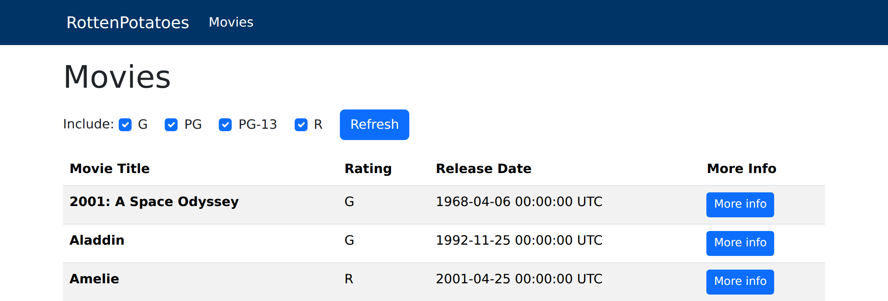

# Part 1: Filter the list of movies by rating

_Suggestion: Read this whole page before starting to code!  There are hints and an overview of the big picture here!_

Enhance RottenPotatoes as follows. At the top of the All Movies listing, add some checkboxes that allow the user to filter the list to show only movies with certain MPAA ratings:



When the Refresh button is pressed, the list of movies is redisplayed showing only those movies whose ratings were checked. If _no_ boxes are checked, after a user hits the Refresh button, all movies should be listed, and all checkboxes should be checked. It also applies to the first time when the user visits the page (i.e. when the user visits the page, all checkboxes should be checked).

This will require a couple of pieces of code. We have provided the code that generates the checkboxes form, which you can include in the `index.html.erb` template.  (The `id` attributes on some of the elements are required for the autograder to work, so don't change/delete them.)

```erb
<%= form_tag movies_path, method: :get, id: 'ratings_form', local: true do %>
  Include:
  <% @all_ratings.each do |rating| %>
    <div class="form-check  form-check-inline">
      <%= check_box_tag "ratings[#{rating}]", "1", @ratings_to_show.include?(rating), class: 'form-check-input' %>
      <%= label_tag "ratings[#{rating}]", rating, class: 'form-check-label' %>
    </div>
  <% end %>
  <%= submit_tag 'Refresh', id: 'ratings_submit', class: 'btn btn-primary' %>
  
<% end %>
```

BUT, you have to do a bit of work to use the above code:

1. As you can see, it expects the variable `@all_ratings` to be an enumerable collection of all possible values of a movie rating, such as `['G','PG','PG-13','R']`. The controller action needs to set up this variable. And since the possible values of movie ratings are really the responsibility of the Movie model, it's best if the controller sets this variable by consulting the Model. Hence, good form would be to create a class method of `Movie` that returns an appropriate value for this collection, say `Movie.all_ratings`, and have the controller assign that to the appropriate instance variable for the view to pick up.

2. The [Rails documentation](https://api.rubyonrails.org/v7.1.5/) for `check_box_tag` says that the third value, evaluated as a Boolean, tells whether the checkbox should be displayed as checked or not.  In the code above, `@ratings_to_show` is assumed to be a collection of which ratings should be checked.  So `@ratings_to_show.include?('G')` would be true if `'G'` was a member of the collection.  The controller action must also set up this array, _even if no check boxes are checked._

<details>
<summary>
Why must the controller set up a default value for
<code>@ratings_to_show</code> even if nothing is checked?
</summary>
<blockquote>
If it doesn't, then <code>@ratings_to_show</code> will have a <code>nil</code> value in the
view, and trying to call <code>nil.include?</code> will cause an exception.
</blockquote>
</details>

You will also need code in the controller that knows (i) how to figure out which boxes the user checked and (ii) how to restrict the database query based on that result.

Regarding (i), try viewing the source (right click and click View Page Source) of the movie listings with the checkbox form, and you'll see that the checkboxes have field names like `ratings[G]`, `ratings[PG]`, etc. This trick will cause Rails to aggregate the values into a single hash called `ratings`, whose keys will be the names of the checked boxes only, and whose values will be the value attribute of the checkbox (which is "1" by default, since we didn't specify another value when calling the `check_box_tag` helper). That is, if the user checks the **G** and **R** boxes, `params` will include as one of its values `:ratings=>{"G"=>"1", "R"=>"1"}`. Check out the `Hash` documentation for an easy way to grab just the keys of a hash, since we don't care about the values in this case (checkboxes that weren't checked don't appear in the `params` hash at all).

Regarding (ii), you'll probably end up replacing `Movie.all` in the controller method. Since most interesting code should go in the model rather than exposing details of the schema to the controller, consider defining a class-level method in the model such as `Movie.with_ratings(ratings)` that takes an array of ratings (e.g. `["r", "pg-13"]`) and returns an ActiveRecord relation of movies whose rating matches (case-insensitively) anything in that array.  To do its job, this method can make use of `Movie.where`, which has various options to help you restrict the database query.

**Hint:** read the [documentation](https://api.rubyonrails.org/v7.1.5/) about `ActiveRecord::Base` (on the docs page, click the flippy triangle next to the class name `ActiveRecord` and find the interior class `Base`) for examples of how to use `where` to do queries like this. The [ActiveRecord Intro CHIPS assignment](/saasbook/hw-activerecord-intro) may be helpful too. You may also find `.present?` convenient.

### IMPORTANT for grading purposes

* As in the code above, your form tag should have the id `ratings_form` and the form submit button for filtering by ratings should have the id `ratings_submit`.
* Each checkbox should have an HTML element id of `ratings_#{rating}`, where the interpolated rating should be the rating itself, such as `ratings_PG-13`, `ratings_G`, and so on.

### More Hints

_We suggest_ adding a class method in `Movie` as follows:

```ruby
class Movie < ApplicationRecord
  def self.with_ratings(ratings_list)
  # if ratings_list is an array such as ['G', 'PG', 'R'], retrieve all
  #  movies with those ratings
  # if ratings_list is nil, retrieve ALL movies
  end
end
```

Using the debugger, take a look at what is in `params[]` when the form is submitted with various checkboxes checked, and particularly, what is in `params[:ratings]` (or `params['ratings']` -- special hashes in Rails such as `params` and `session` can be accessed by either strings or symbols, even though hashes in Ruby do not generally behave this way).

Notice that you will need to use the `params[:ratings]` values in two ways in the controller: to determine what values to pass to `Movie.with_ratings`, and to set a variable that can be used by the view so that the appropriate checkboxes show up as checked when the filtered view is loaded.

### To pay attention to...

**Labels** You may notice that we have included a HTML `label` alongside the checkbox. These labels are critical for a properly functioning form! Primarily, they tell users what checkbox they are about to select. However, labels also provide built-in accessibility features (such as for blind users, so they too know what each checkbox does) or handy shortcuts like clicking "G" to apply the "G" checkbox. (On a phone, for example, this means users are less likely to tap on the wrong action.)

**Reminder** Don't put logic in your views! If you find yourself doing computation in your views, set up an instance variable in the controller and do the computation there instead. And if the computation is anything more than trivial, it probably belongs in a model, not in the controller.

## Deploying this feature

Once you've verified that your code works (by running the Rails server locally and trying it), we'll try deploying what we've made so far. This time, let's use the `main` branch of your repository. That means we'll have to merge our current branch into `main`, which is most easily accomplished with a pull request on GitHub.

First, **make a commit** to your feature branch with all of your changes, then push the branch's updates to GitHub. Use the same technique as in previous CHIPS to create a pull request, then merge that pull request into your repository's `main` branch.

Once you've done this, your GitHub repository's `main` branch will be up to date with your latest changes. Check out the `main` branch on your local repository:

```sh
git checkout main
```

Then, you can pull the new, updated version of `main` from the `origin` remote (your GitHub repository) into your local repository:

```sh
git pull origin main
```

And, since you won't need the feature branch anymore, you can clean up by deleting the local branch:

```sh
git branch -d <OLD_BRANCH_NAME>
```

There's also a button on GitHub that will do this for you for the copy of the branch that existed on the remote.

Now, we can deploy the updated `main` branch. Different teams will have different approaches, but it's common to deploy to the production web server only from the `main` branch, rather than making deploys from potentially out-of-date feature branches.

Merging the pull request already pushed your changes to `main` on GitHub, which is the branch Render watches, so the deploy is underway: follow it in the build logs on your service's page in the Render dashboard until the service goes Live again. (On Heroku, you would instead deploy by pushing to the `heroku` remote: `git push heroku main`.)

Have a peek at the new changes and make sure they're working properly before moving onto the next section.

---

[← Part 0 (B): Preparation: deploy to the cloud](03-Part-0--B---Preparation--deploy-to-Heroku.md) | [Contents](README.md) | [Part 2: Sort the list of movies →](05-Part-2--Sort-the-list-of-movies.md)
