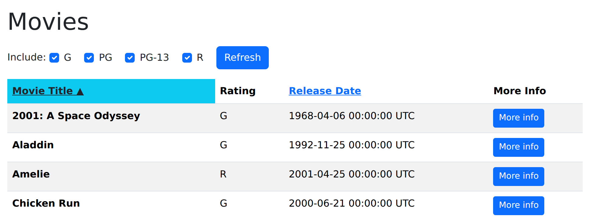

# Part 2: Sort the list of movies

First, let's make a new feature branch for the next step. This time, we're adding a sorting functionality, so consider naming your branch something relevant to the feature you'll be implementing. Again, if you're pair programming, please include both GitHub usernames in the branch name.

```sh
git checkout -b <NEW_BRANCH_NAME>
```

On the list of all movies page, make the "Movie Title" and "Release Date" column headers clickable. Clicking on one of them should cause the list to be reloaded but sorted in ascending order on that column. For example, clicking the "Release Date" header should redisplay the list of movies with the earliest-released movies first; clicking the "Title" header should list the movies alphabetically by title. (For movies whose names begin with non-letters, the sort order should match the behavior of `String#<=>`.) When the listing page is redisplayed, the header of the column that is being sorted on should be highlighted.

We have provided the code for the two clickable headers. In `index.html.erb`, replace the plain `<th scope="col">Movie Title</th>` and `<th scope="col">Release Date</th>` cells with these. (The `id` attributes are required for the autograder to work, so don't change/delete them.)

```erb
<th scope="col" aria-sort="<%= sort_aria('title') %>" class="<%= sort_classes('title') %>">
  <%= link_to movies_path(sort_by: 'title'), id: 'title_header' do %>
    Movie Title<%= sort_indicator('title') %>
  <% end %>
</th>
```

```erb
<th scope="col" aria-sort="<%= sort_aria('release_date') %>" class="<%= sort_classes('release_date') %>">
  <%= link_to movies_path(sort_by: 'release_date'), id: 'release_date_header' do %>
    Release Date<%= sort_indicator('release_date') %>
  <% end %>
</th>
```

Those headers call three helper methods, which go in `app/helpers/movies_helper.rb`. Helpers are the right home for this kind of code: it is presentation logic that would otherwise be repeated in every column header.

```ruby
module MoviesHelper
  # Is the movie list currently sorted by this column?
  def sorted_by?(column)
    @sort_by.to_s == column.to_s
  end

  # Value for the header cell's `aria-sort` attribute. This is what tells a
  # screen reader which column the table is sorted by, so only the sorted
  # column may have a value other than "none".
  def sort_aria(column)
    sorted_by?(column) ? 'ascending' : 'none'
  end

  # Bootstrap classes that highlight the header of the sorted column. bg-info
  # is a light cyan, so the text on top of it has to stay dark to keep enough
  # contrast to be readable.
  def sort_classes(column)
    'hilite bg-info text-dark' if sorted_by?(column)
  end

  # The little arrow next to the sorted column's name. It is decorative:
  # `aria-hidden` keeps screen readers from announcing "▲", because the
  # `aria-sort` attribute above already says the same thing in words.
  def sort_indicator(column)
    tag.span(' ▲', 'aria-hidden': true) if sorted_by?(column)
  end
end
```

As you can see, the provided code expects the controller to set `@sort_by` to the name of the column being sorted on—that part is your job, as is actually returning the movies in sorted order.

The result should look something like this, with the header of the column being sorted on highlighted:



**Note** Initially, you will probably find that when you click on a sort column, the app will "forget" which checkboxes have been checked. Similarly, when you sort on a column but then you change which checkboxes are checked, the app will "forget" the desired sort order. We'll fix these cases later.

### To pay attention to: what makes a sortable table accessible

Clickable column headers are a small piece of UI with a surprising number of ways to go wrong for someone who isn't looking at the screen. The code above is written the way it is on purpose:

* **`scope`** tells assistive technology which cells a header labels: `scope="col"` for the column headers, and `scope="row"` on the movie title in `_movie_row.html.erb`, since the title is what identifies each row. Without it, a screen reader reading a cell in the middle of the table can't say which movie and which column it belongs to.
* **`aria-sort`** announces which column the table is sorted by and in which direction. That is why exactly one header may have a value other than `none`, and why `sort_aria` returns `'none'` for the others.
* **The ▲ indicator is `aria-hidden`.** It repeats visually what `aria-sort` says in words, and "black up-pointing triangle" is not a useful thing to hear. Note also that highlighting alone would not be enough: information can never be conveyed by color (or by a tiny arrow) *only*.
* **The header is a real link.** Because `link_to` emits an `<a href="...">`, it is reachable with the Tab key, activated with Enter, and shows up in a screen reader's list of links, all for free. A `<div>` with a JavaScript click handler would look identical on screen and be unusable without a mouse.
* **The highlight has enough contrast.** White text on Bootstrap's `bg-info` is a contrast ratio of about 1.9:1, well under the 4.5:1 that [WCAG](https://www.w3.org/WAI/WCAG22/quickref/#contrast-minimum) requires for body text, so the highlighted header uses dark text instead.
* **The table has a `<caption>`.** It is hidden visually (Bootstrap's `visually-hidden` class), but it gives screen reader users a summary of what the table holds before they start reading rows. Once your column headers sort, it is worth saying so in the caption too.

**IMPORTANT for grading purposes:**

* As in the code above, your column headers should have the ids `title_header` and `release_date_header`, and the header of the column currently sorted on should have the class `hilite`.
* The form submit button for filtering by ratings should still have the id `ratings_submit`, and the table of movies should keep the id `movies`.

### Hint: Adding parameters to existing RESTful routes

The current RottenPotatoes views use the Rails-provided "resource-based routes" helper `movies_path` to generate the correct URI for the movies index page. You may find it helpful to know that if you pass this helper method a hash of additional parameters, those parameters will be parsed by Rails and available in the `params[]` hash. To play around with this behavior, you can [test out routes in the Rails console](https://stackoverflow.com/questions/1397644/testing-routes-in-the-console). (How did I find this secret information? I Googled "test routes in rails console".)

That is exactly what the `link_to movies_path(sort_by: 'title')` in the column headers above is doing: it points at the RESTful route for fetching the movie list, with one extra parameter that tells the controller which column header was clicked, so `params[:sort_by]` will be `'title'`. **Hint:** Remember that every parameter in a route has a key and a value, so any argument you pass to `movies_path` has to be a hash—which is what you'll take advantage of below, when the headers need to remember the checkbox filters too.

### Hint: displaying things in the right order

Databases are pretty good at returning collections of rows in sorted order according to one or more attributes. Before you rush to sort the collection returned from the database, look at the [documentation](https://api.rubyonrails.org/v7.1.5/) for `ActiveRecord.order` and see if you can get the database to do the work for you.

Don't put logic in your views! The view shouldn't have to sort the collection itself—its job is just to show stuff. The controller should spoon-feed the view exactly what is to be displayed.

## Remembering both the sort order and filtering order

At this point, you should have sort columns working, but you probably noticed that sorting on a column "forgets" the values of which checkboxes were checked. Let's fix that.

The key to fixing it is to remember that when we constructed the form for the checkboxes in part 1, the only thing that was needed to pass to the controller was the info about which checkboxes were checked. For example, if the boxes whose field names were `ratings_G` and `ratings_PG` were checked, `params[:ratings]` would contain a hash `{'G': '1', 'PG': '1'}`. (HTML allows a checked box to be given any value, but we chose "1" which is conventional since the value is usually irrelevant, since if the checkbox is not checked, it doesn't appear in the submitted form values at all.)

So if we could _also_ include this info in the link when the user clicks a column name, the info would be passed into the controller action along with the column name itself!

Now, the view already knows that the value `@ratings_to_show` is an array containing only the values for the boxes that were checked--for example, something like `['G','R']`. But to make it look right for `params`, we need to pass `movies_path()` something that looks more like `{'G':'1', 'R':'1'}` (or really, any value other than `'1'` is fine, since it's just the presence of the key that matters).

Judiciously using a seach engine or AI, find and test a concise way to derive a hash whose keys are the values of an array, and whose value for all the keys is some constant like `'1'`. With that in hand, modify the arguments to the `movies_path()` route helper already used by your column headers to include that hash, such that the information about which checkboxes were checked on the form appears as part of the route.

At this point, you should be able to refresh the view by _either_ clicking on a column header _or_ clicking the Refresh button, and both types of changes should be "remembered".

There is a minor corner case though—changing the checkbox filters and then clicking on a column header (instead of the submit button) should **not** cause the changes to ratings filters be "remembered" and should not result in the checkbox filter changing when the page is refreshed.

## Deploying again

We could use the same strategy as the last part to deploy. This time, though, let's do it without a pull request. Pull requests are great, but it's good to see how branch merging works straight from the command line, rather than always relying on the big green button in GitHub to make a merge commit for you.

First, stage your changes and commit them to the feature branch you created. Then, check out your `main` branch:

```sh
git checkout main
```

When you're about to merge one branch into another, it's always good practice to start by making sure your target branch is up to date with the remote:

```sh
git pull origin main
```

Of course, you won't have any new changes on `main` to pull, since there's no one else making changes to the repository right now. Still, it's good to get in the habit of checking that you're up-to-date with the remote! Even on solo projects, it's easy to get tripped up by working on multiple computers.

Now, let's manually merge the new feature branch into `main`. This is what GitHub is doing when you press the "Merge pull request" button.

```sh
git merge <FEATURE_BRANCH_NAME>
```

<details>
  <summary><strong>Self Check Question:</strong> What would happen if, while you were working on your feature branch, someone else had made changes to the <code>main</code> branch of the remote on the same parts of the same files you just edited?</summary>
  <p><blockquote>This is where the dreaded <em>merge conflict</em> comes from. When you run <code>git merge</code>, Git will check whether your changes conflict with changes made in the branch you're merging into. If there are conflicts, you'll be asked to resolve those conflicts yourself before committing the merge. Fortunately, in this homework, <code>main</code> hasn't been updated since you created your feature branch off the <code>main</code> branch, so merging will be a breeze.</blockquote></p>
</details>

This will update the `main` branch to include the commits from your feature branch. Now, you can delete the feature branch and push `main` to the remote:

```sh
git branch -d <FEATURE_BRANCH_NAME>
git push origin main
```

Again, when you're merging into `main`, it's typically better to use the pull request flow; we used the manual merge technique here just to give you a peek under the hood. One risk of doing the merge-to-main process yourself is that things get messy if two people try to merge their feature branches into `main` at the same time. Git's distributed nature, with a copy of the repository on each system, means there's nothing preventing two people from making changes to the `main` branch at the same time. GitHub's merge button will quickly perform the merges in sequence for you, applying one at a time to prevent this issue.

Now that we've got our code on the `main` branch, the `git push origin main` above is all the deploy Render needs. (On Heroku, you would also run `git push heroku main`.)

Check that it's working on your deployed site!

---

[← Part 1: Filter the list of movies by rating](04-Part-1--Filter-the-list-of-movies-by-rating.md) | [Contents](README.md) | [Part 3: Remember the sorting and filtering settings →](06-Part-3--Remember-the-sorting-and-filtering-settings.md)
